# AWS Networking Lab

A hands-on AWS networking project demonstrating how an EC2 instance communicates with the internet through a VPC, subnet, route table, Internet Gateway, Network ACL, and Security Group.

## Project Overview

This lab was built to understand and troubleshoot the complete network path between an internet client and an AWS EC2 instance.

The environment includes:

- Custom AWS VPC
- Public subnet
- Internet Gateway
- Route table
- Network ACL
- Security Group
- Ubuntu 24.04 EC2 instance
- Nginx web server

The lab also includes controlled networking tests where Security Group and Network ACL rules were intentionally changed to observe how they affect connectivity.

## Architecture

The lab uses a simplified representation of the AWS networking components involved in internet connectivity:

```text
Internet
   |
   v
Internet Gateway
   |
   v
VPC: 172.31.0.0/16
   |
   v
Route Table
   |
   | 0.0.0.0/0 -> Internet Gateway
   v
Public Subnet: 172.31.32.0/20
   |
   v
Network ACL
   |
   v
Security Group
   |
   v
EC2 Instance
   |
   v
Nginx :80
   |
   v
HTTP Response
```

The diagram is intentionally simplified. The route table determines where traffic is routed, while Network ACLs and Security Groups provide traffic filtering at different layers.
## Architecture Diagram


## Screenshots

### VPC and Subnet Configuration

The VPC and subnet configuration used for this networking lab.

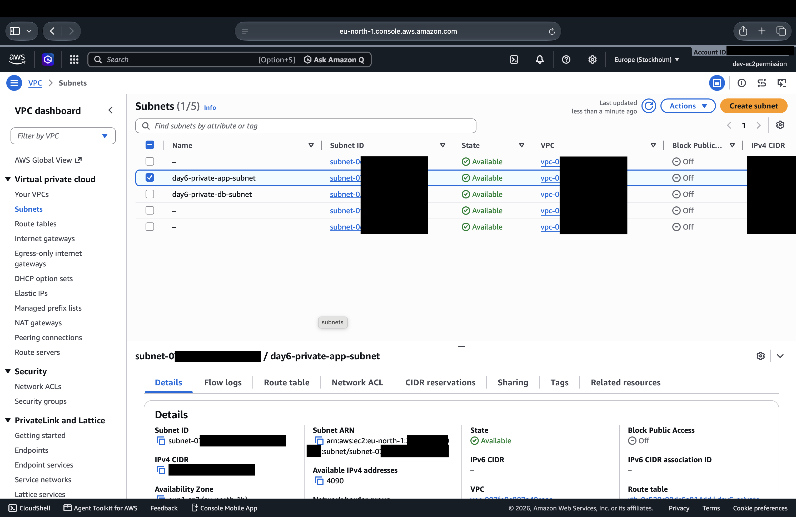

### Route Tables

Route table configuration showing how network traffic is routed.

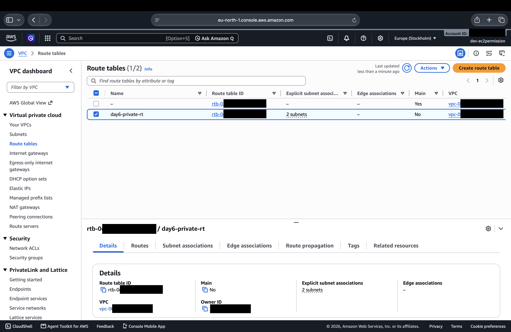

### Security Groups

Security groups configured for the web, application, and database tiers.

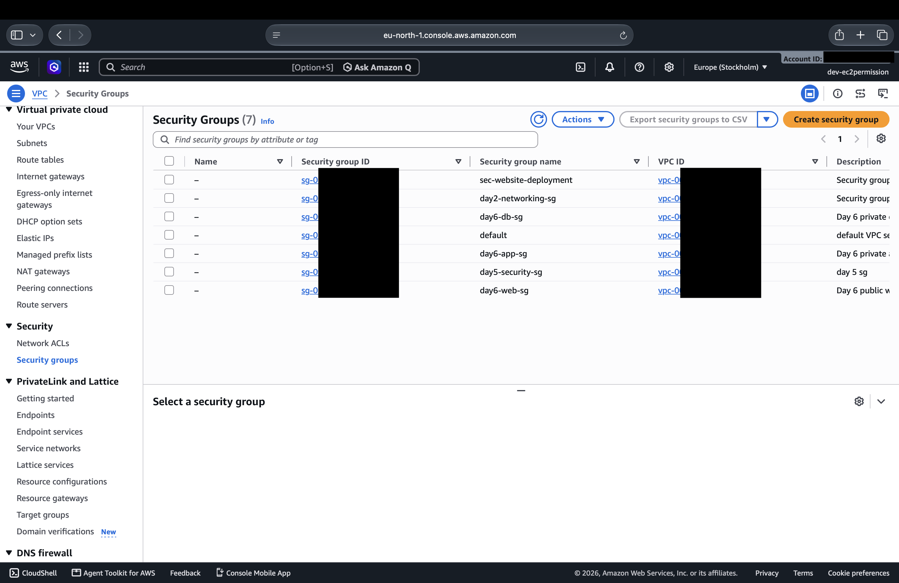

### Web Security Group — Inbound Rules

Inbound traffic rules for the web tier.

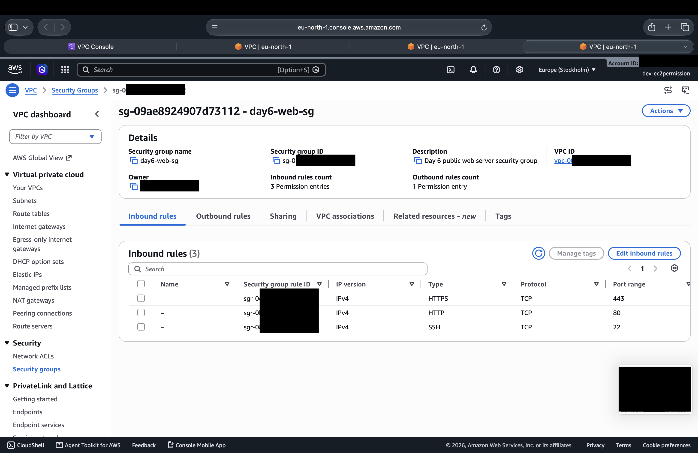

### Application Security Group — Inbound Rules

Inbound traffic rules for the application tier.

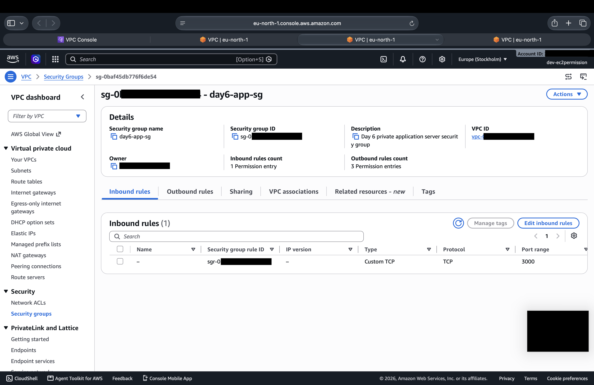

### Application Security Group — Outbound Rules

Outbound traffic rules for the application tier.

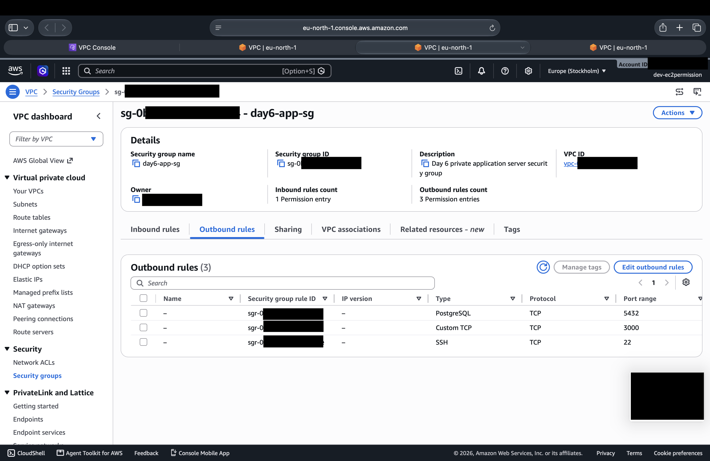

### Database Security Group — Inbound Rules

Inbound traffic rules for the database tier.

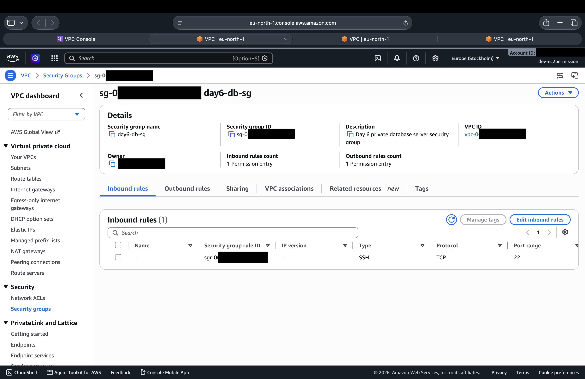

### Database Security Group — Outbound Rules

Outbound traffic rules for the database tier.

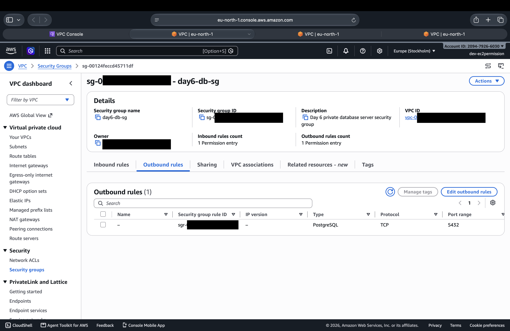

### Running EC2 Instances

EC2 instances used during the networking exercises.

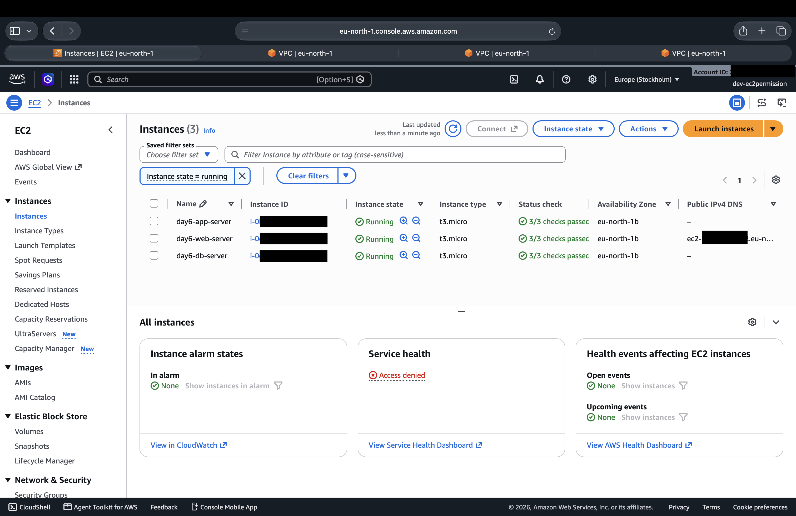

### Successful Connectivity Test

Evidence of a successful network connectivity test.

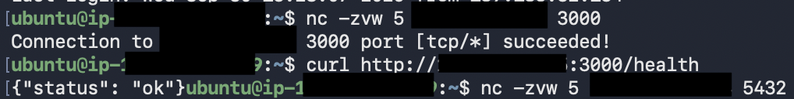

### Connectivity Troubleshooting

Evidence collected while diagnosing a connection failure.

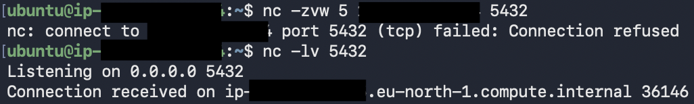
## AWS Infrastructure

### VPC

- VPC CIDR: `172.31.0.0/16`
- VPC ID: created for this lab

### Subnet

- Subnet CIDR: `172.31.32.0/20`
- Availability Zone: `eu-north-1b`
- Subnet ID: created for this lab
- Public IPv4 address assignment: Enabled

### Route Table

- Route table: created for this lab

Routes:

| Destination | Target | Status |
|---|---|---|
| `172.31.0.0/16` | Local | Active |
| `0.0.0.0/0` | Internet Gateway | Active |

### Internet Gateway

- Internet Gateway: created for this lab
- Used to provide internet connectivity for the public subnet.

### EC2 Instance

- Instance type: `t3.micro`
- Operating system: Ubuntu 24.04 LTS
- Availability Zone: `eu-north-1b`
- Private IP: assigned dynamically by AWS
- Network interface: `ens5`

### Security Group

- Name: `day2-networking-sg`

Inbound rules used during the lab:

| Protocol | Port | Source | Purpose |
|---|---:|---|---|
| TCP | 22 | My IP | SSH administration |
| TCP | 80 | `0.0.0.0/0` | HTTP access |

### Network ACL

- Network ACL: created for this lab

Default lab rules:

| Direction | Rule | Protocol | Port | Source/Destination | Action |
|---|---:|---|---|---|---|
| Inbound | 100 | All | All | `0.0.0.0/0` | Allow |
| Outbound | 100 | All | All | `0.0.0.0/0` | Allow |

The default `*` rules act as the catch-all deny rules after the numbered rules are evaluated.

## Connectivity Testing

### Test 1 — Security Group Blocking HTTP

The Nginx service was running successfully on the EC2 instance.

Local test:

    curl -I http://127.0.0.1

The EC2 instance returned `HTTP/1.1 200 OK`, confirming that Nginx was healthy locally.

However, HTTP access from the Mac initially failed because TCP port 80 was not allowed by the EC2 Security Group.

After adding this inbound Security Group rule:

- Protocol: TCP
- Port: 80
- Source: `0.0.0.0/0`
- Action: Allow

the HTTP request from the Mac returned `HTTP/1.1 200 OK`.

### What this demonstrated

A service can be running correctly on an EC2 instance while external connectivity is blocked by the Security Group.

The Security Group controls traffic reaching the instance network interface.

---

### Test 2 — Network ACL Blocking HTTP

After confirming that the Security Group allowed HTTP traffic, a temporary Network ACL rule was added:

- Rule number: `90`
- Protocol: TCP
- Port: 80
- Source: `0.0.0.0/0`
- Action: Deny

The Security Group continued to allow TCP port 80.

A fresh HTTP request from the Mac then timed out:

    curl -I --max-time 10 http://<EC2-PUBLIC-IP>

This demonstrated that the Network ACL could block the traffic even though the Security Group allowed it.

The temporary NACL rule was then removed.

After removing the deny rule, the same HTTP request once again returned `HTTP/1.1 200 OK`.

### Key Lesson

Traffic must successfully pass through the relevant network controls before it can reach the application.

The simplified traffic path was:

    Internet
       |
       v
    Internet Gateway
       |
       v
    Network ACL
       |
       v
    Security Group
       |
       v
    EC2
       |
       v
    Nginx :80

The experiment demonstrated the difference between:

- **Security Groups** — stateful, instance/network-interface level
- **Network ACLs** — stateless, subnet level

## Linux Networking and Troubleshooting

The EC2 instance was inspected using standard Linux networking tools.

### Network Interface

The following command was used to inspect the primary network interface:

    ip addr show ens5

The interface showed the private IPv4 address:

    <EC2-PRIVATE-IP>/20

This confirmed that the EC2 instance was attached to the expected subnet.

### Routing Table

The routing table was inspected with:

    ip route

The important routes were:

    default via <SUBNET-GATEWAY> dev ens5
    172.31.32.0/20 dev ens5

The default route sends traffic for destinations outside the local subnet through the subnet gateway.

The `172.31.32.0/20` route represents the directly connected subnet.

### Local Service Testing

Nginx was tested locally from the EC2 instance:

    curl -I http://127.0.0.1

A successful `HTTP 200 OK` response confirmed that the web server itself was functioning.

### External Connectivity Testing

HTTP connectivity was tested from the Mac using:

    curl -I --max-time 10 http://<EC2-PUBLIC-IP>

This test was useful for distinguishing between:

- Application/service problems
- EC2 operating system problems
- Security Group restrictions
- Network ACL restrictions
- AWS routing problems

### Troubleshooting Methodology

The lab followed a layered troubleshooting approach:

1. Verify the application locally.
2. Verify the EC2 network interface.
3. Verify the Linux routing table.
4. Verify the subnet route table.
5. Verify the Internet Gateway.
6. Verify the Network ACL.
7. Verify the Security Group.
8. Test connectivity externally.
9. Change one network control at a time.
10. Retest after each change.

This approach helps isolate the layer responsible for a connectivity failure instead of changing multiple components at once.

## Lessons Learned

### 1. EC2 Has Multiple Networking Layers

An EC2 instance does not communicate directly with the internet. Traffic passes through multiple AWS networking components, including the subnet, route table, Internet Gateway, Network ACL, and Security Group.

### 2. Private and Public IP Addresses Have Different Roles

The EC2 instance used a private IPv4 address inside the VPC while AWS provided a public IPv4 address for internet communication.

The private address is used for communication inside the VPC, while the public address provides external reachability when the relevant AWS networking configuration allows it.

### 3. Route Tables Determine Where Traffic Goes

The route:

    0.0.0.0/0 -> Internet Gateway

allowed traffic destined for external networks to leave the VPC through the Internet Gateway.

### 4. Security Groups Are Stateful

Security Groups operate at the instance/network-interface level and are stateful. When an inbound connection is permitted, the response traffic is automatically permitted for that established connection.

### 5. Network ACLs Are Stateless

Network ACLs operate at the subnet level and are stateless. In more restrictive configurations, both inbound and outbound traffic must be explicitly permitted.

NACL rules are evaluated in ascending rule-number order, and the first matching rule is applied.

### 6. Local Testing and External Testing Are Different

A successful:

    curl -I http://127.0.0.1

only proves that the service is running locally on the EC2 instance.

It does not prove that the service is reachable from the internet.

External connectivity requires the complete network path to be correctly configured.

### 7. Change One Network Layer at a Time

During troubleshooting, changing multiple networking components simultaneously makes it difficult to identify the cause of a failure.

This lab intentionally changed one control at a time and retested the connection after each change.

## Cleanup

For a temporary lab environment, unused AWS resources should be stopped or terminated after testing to avoid unnecessary charges.

Before deleting resources, verify that they are not required by another project.

Resources created or modified during this lab included:

- EC2 instance
- Security Group
- VPC networking components
- Nginx web server

## Conclusion

This project provided hands-on experience with AWS VPC networking and demonstrated how traffic flows from an external client to an EC2-hosted web server.

The lab also demonstrated practical troubleshooting by intentionally introducing network failures and identifying which layer was responsible for blocking connectivity.

The main goal was not only to configure the environment, but to understand how each networking layer contributes to successful connectivity.
